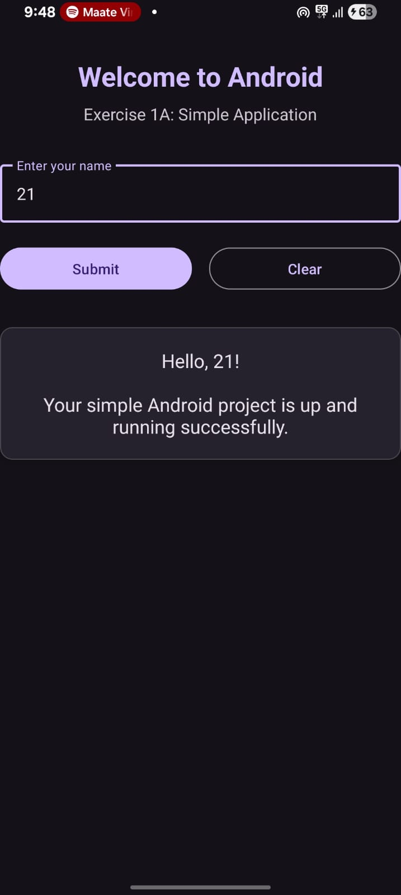

# INSTALLING AND RUNNING APPLICATIONS ON ANDROID STUDIO

## AIM

To install and configure Android Studio and develop, build, and run an Android application using Java and XML. To understand the Android Studio development environment and execute an application on an Android Emulator or physical Android device.

## PROCEDURE

1. Download Android Studio from the official Android Developer website.
2. Install Android Studio by following the installation wizard.
3. Launch Android Studio and complete the initial SDK setup.
4. Select **New Project** to create a new Android application.
5. Choose an appropriate project template, such as Empty Views Activity.
6. Enter the application name, package name, programming language (Java), and minimum SDK version.
7. Click **Finish** and wait for the project to be created.
8. Open `MainActivity.java` to write the application logic.
9. Open `activity_main.xml` to design the user interface.
10. Connect an Android Emulator or enable USB Debugging on a physical Android device.
11. Click the **Run** button in Android Studio to build and execute the application.
12. Verify that the application runs successfully on the selected device.

## PROGRAM

### MainActivity.java

```
package com.example.ex1a;

import android.os.Bundle;
import android.text.TextUtils;
import android.widget.Button;
import android.widget.EditText;
import android.widget.TextView;
import android.widget.Toast;

import androidx.activity.EdgeToEdge;
import androidx.appcompat.app.AppCompatActivity;
import androidx.core.graphics.Insets;
import androidx.core.view.ViewCompat;
import androidx.core.view.WindowInsetsCompat;

import com.google.android.material.textfield.TextInputLayout;

public class MainActivity extends AppCompatActivity {

    private TextInputLayout tilName;
    private EditText etName;
    private TextView tvGreeting;

    @Override
    protected void onCreate(Bundle savedInstanceState) {
        super.onCreate(savedInstanceState);
        EdgeToEdge.enable(this);
        setContentView(R.layout.activity_main);

        ViewCompat.setOnApplyWindowInsetsListener(findViewById(R.id.main), (v, insets) -> {
            Insets systemBars = insets.getInsets(WindowInsetsCompat.Type.systemBars());
            v.setPadding(systemBars.left, systemBars.top, systemBars.right, systemBars.bottom);
            return insets;
        });

        // Initialize UI views
        tilName = findViewById(R.id.tilName);
        etName = findViewById(R.id.etName);
        Button btnSubmit = findViewById(R.id.btnSubmit);
        Button btnClear = findViewById(R.id.btnClear);
        tvGreeting = findViewById(R.id.tvGreeting);

        // Submit button click listener
        btnSubmit.setOnClickListener(v -> {
            String name = etName.getText() != null ? etName.getText().toString().trim() : "";
            if (TextUtils.isEmpty(name)) {
                tilName.setError(getString(R.string.empty_name_error));
                Toast.makeText(MainActivity.this, R.string.empty_name_error, Toast.LENGTH_SHORT).show();
            } else {
                tilName.setError(null);
                String welcomeMessage = "Hello, " + name + "!\n\nYour simple Android project is up and running successfully.";
                tvGreeting.setText(welcomeMessage);
                Toast.makeText(MainActivity.this, "Welcome, " + name + "!", Toast.LENGTH_SHORT).show();
            }
        });

        // Clear button click listener
        btnClear.setOnClickListener(v -> {
            etName.setText("");
            tilName.setError(null);
            tvGreeting.setText(R.string.default_greeting);
            Toast.makeText(MainActivity.this, "Cleared", Toast.LENGTH_SHORT).show();
        });
    }
}

```

### activity_main.xml

```
<?xml version="1.0" encoding="utf-8"?>
<androidx.constraintlayout.widget.ConstraintLayout xmlns:android="http://schemas.android.com/apk/res/android"
    xmlns:app="http://schemas.android.com/apk/res-auto"
    xmlns:tools="http://schemas.android.com/tools"
    android:id="@+id/main"
    android:layout_width="match_parent"
    android:layout_height="match_parent"
    android:padding="24dp"
    tools:context=".MainActivity">

    <TextView
        android:id="@+id/tvTitle"
        android:layout_width="wrap_content"
        android:layout_height="wrap_content"
        android:text="@string/title_text"
        android:textSize="26sp"
        android:textStyle="bold"
        android:textColor="?attr/colorPrimary"
        app:layout_constraintTop_toTopOf="parent"
        app:layout_constraintStart_toStartOf="parent"
        app:layout_constraintEnd_toEndOf="parent"
        android:layout_marginTop="32dp" />

    <TextView
        android:id="@+id/tvSubtitle"
        android:layout_width="wrap_content"
        android:layout_height="wrap_content"
        android:text="@string/subtitle_text"
        android:textSize="16sp"
        android:textColor="?android:attr/textColorSecondary"
        app:layout_constraintTop_toBottomOf="@id/tvTitle"
        app:layout_constraintStart_toStartOf="parent"
        app:layout_constraintEnd_toEndOf="parent"
        android:layout_marginTop="8dp" />

    <com.google.android.material.textfield.TextInputLayout
        android:id="@+id/tilName"
        style="@style/Widget.Material3.TextInputLayout.OutlinedBox"
        android:layout_width="0dp"
        android:layout_height="wrap_content"
        android:hint="@string/name_hint"
        app:layout_constraintTop_toBottomOf="@id/tvSubtitle"
        app:layout_constraintStart_toStartOf="parent"
        app:layout_constraintEnd_toEndOf="parent"
        android:layout_marginTop="32dp">

        <com.google.android.material.textfield.TextInputEditText
            android:id="@+id/etName"
            android:layout_width="match_parent"
            android:layout_height="wrap_content"
            android:inputType="textPersonName"
            android:maxLines="1" />
    </com.google.android.material.textfield.TextInputLayout>

    <com.google.android.material.button.MaterialButton
        android:id="@+id/btnSubmit"
        android:layout_width="0dp"
        android:layout_height="wrap_content"
        android:text="@string/submit_button"
        app:layout_constraintTop_toBottomOf="@id/tilName"
        app:layout_constraintStart_toStartOf="parent"
        app:layout_constraintEnd_toStartOf="@id/btnClear"
        android:layout_marginTop="20dp"
        android:layout_marginEnd="8dp" />

    <com.google.android.material.button.MaterialButton
        android:id="@+id/btnClear"
        style="@style/Widget.Material3.Button.OutlinedButton"
        android:layout_width="0dp"
        android:layout_height="wrap_content"
        android:text="@string/clear_button"
        app:layout_constraintTop_toBottomOf="@id/tilName"
        app:layout_constraintStart_toEndOf="@id/btnSubmit"
        app:layout_constraintEnd_toEndOf="parent"
        android:layout_marginTop="20dp"
        android:layout_marginStart="8dp" />

    <com.google.android.material.card.MaterialCardView
        android:id="@+id/cardGreeting"
        android:layout_width="0dp"
        android:layout_height="wrap_content"
        app:cardCornerRadius="12dp"
        app:cardElevation="4dp"
        app:layout_constraintTop_toBottomOf="@id/btnSubmit"
        app:layout_constraintStart_toStartOf="parent"
        app:layout_constraintEnd_toEndOf="parent"
        android:layout_marginTop="32dp">

        <TextView
            android:id="@+id/tvGreeting"
            android:layout_width="match_parent"
            android:layout_height="wrap_content"
            android:padding="20dp"
            android:text="@string/default_greeting"
            android:textAlignment="center"
            android:textSize="18sp"
            android:textColor="?android:attr/textColorPrimary" />
    </com.google.android.material.card.MaterialCardView>

</androidx.constraintlayout.widget.ConstraintLayout>
```

## OUTPUT


## RESULT

Thus, Android Studio was successfully installed and configured, and a simple Android application was created, built, and executed successfully.
